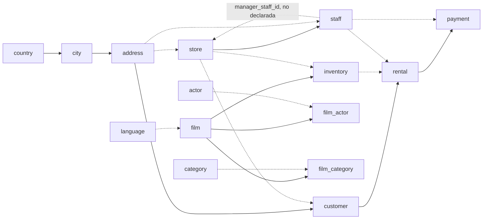
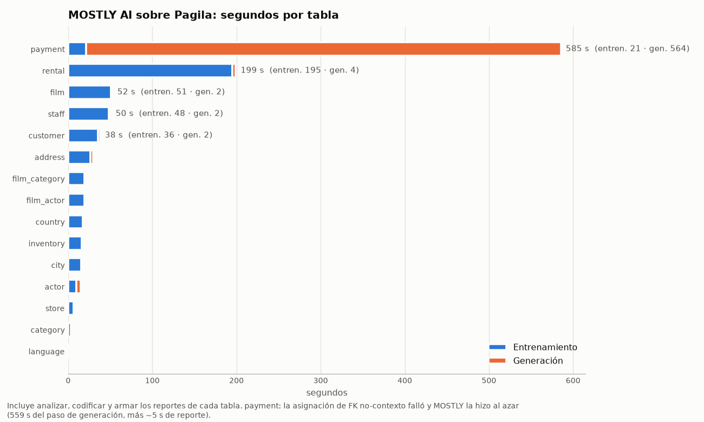

# D2 — MOSTLY AI (SDK local) — Sintetizar

**Quién / cuándo:** Jero, 2026-10-10 / 2026-10-11.
**Fuente de cada dato:** D = documentación, P = prueba propia. Salvo donde dice D, todo es P. «Código» = leído en el código fuente de la versión instalada.

[← Puerta de entrada](../../docs/README.md) · [Comparativa de síntesis](../../docs/comparativa.md#d--sintetizar) · [Glosario](../../docs/glosario-y-metodo.md)

## En pocas palabras

- MOSTLY AI (SDK gratuito, corriendo en la Mac) aprendió de Pagila y generó una versión sintética de sus 15 tablas: **8,5 min de entrenamiento, 12,1 de generación y hasta 8,1 GB de memoria**.
- **Ninguna clave huérfana**, pero **269 filas duplicadas** en tablas de relación. Por eso la base no se puede restaurar con todas sus restricciones.
- **Calidad 0,768** (SDMetrics): se parece a la real en fechas y montos, pero borró las tablas de catálogo (todo `_RARE_`) e inventa nombres y correos carácter por carácter.
- **Privacidad muy buena:** riesgo ≈ 0 y ninguna persona copiada.

## Entorno

- Equipo: Mac M5 Pro (arm64), 16 GB de RAM, macOS 26. Docker Desktop con 8 GB asignados (la base corre en el contenedor `pagila-db`).
- Herramienta: SDK `mostlyai` 6.1.4 en **modo local** (`MostlyAI(local=True)`), con `mostlyai-engine` 2.7.0 (motor tabular) y `mostlyai-qa` 1.10.8 (reportes de calidad). Usa torch 2.13.0, pandas 3.0.6, numpy 2.5.3 y Python 3.12.0.
- **Entorno de Python aparte** (`Desktop/Tesis/.venv`, fuera del repo). mostlyai 6.1 exige `torch>=2.13,<2.14` y el lock del repo trae `torch 2.14.1`; además usa numpy 2, y el lock está fijado en numpy 1.26 por Anonymeter. No pueden compartir entorno. La exportación, la carga y la evaluación corren en el `.venv` del repo; solo el entrenamiento y la generación corren en el de MOSTLY.
- **Dispositivo: CPU.** torch detecta la GPU de Apple (MPS), pero el motor tabular elige `cuda` si está disponible y, si no, `cpu`; nunca `mps` (código: `mostlyai/engine/_tabular/common.py` y `training.py`). En una Mac, todo el entrenamiento es por CPU.
- Datos: `e3_entrenamiento` = Pagila (pagila-v4.0.0) sin los 200 clientes de control de E3, con sus alquileres, pagos y direcciones exclusivas. Son 15 tablas y 100 779 filas. Se entrena sin el control para poder medir la privacidad después (ver `pruebas/E3-chequeos-propios`).
- Script: `d2_mostlyai.py` (esta carpeta), con tres pasos: `exportar`, `entrenar` y `cargar`.

## Qué dice la documentación (D) y cómo se aplicó a Pagila

**Licencia y modos.** El SDK es Apache-2.0. En modo local entrena y genera en la propia máquina; también tiene un modo cliente contra la plataforma de MOSTLY. Se instala con `mostlyai[local]` (incluye PyTorch). Hay un extra `local-gpu`, recomendado para modelos de lenguaje, y conectores opcionales a bases de datos (`postgres`, `mysql`, etc.). Pide Python ≥ 3.11. *(README del repositorio `mostly-ai/mostlyai`.)*

**Qué genera.** Datos tabulares de tipos mixtos (categóricos, numéricos, fechas, geoespaciales, texto), de una tabla, multi-tabla y series de tiempo. El texto libre puede ir con un modelo de lenguaje (LSTM propio o un modelo de Hugging Face). *(README.)*

**Multi-tabla: contexto y no-contexto.**

- Cada FK de una tabla se declara como **de contexto** o **no-contexto**, y **solo una por tabla puede ser de contexto** (D; también figura en el esquema `SourceForeignKeyConfig` del SDK).
- Con la de contexto, el generador «puede retener por completo las correlaciones y mantener la integridad referencial».
- Una no-contexto «mantiene solo la integridad referencial».
- Si una tabla tiene varias FK, la de contexto tiene que ser la de la tabla con la que más interesa conservar las correlaciones. *(Página «Multi-table relationships».)*

**Qué entra como contexto al generar cada fila** (procesador secuencial):

- Entran el padre, el abuelo, los hermanos de la misma tabla, los hermanos de otras tablas bajo el mismo padre, y los hermanos del padre.
- No entran los «primos» (filas bajo otros padres) ni los descendientes. *(Página «Context processing in multi-table datasets».)*

**Caso especial que aplica a Pagila.** Una tabla hija que referencia a su padre **y también a su abuelo** «puede tener problemas durante el entrenamiento». La solución sugerida es sacar la columna de la FK al abuelo del entrenamiento y reconstruirla después de generar (D). En Pagila es `payment`, que apunta a `rental` (padre) y a `customer`, que ya es padre de `rental`.

**Privacidad** (D, esquema del SDK):

- Por defecto aplica *value protection*, que protege categorías raras, valores extremos y largos de secuencia.
- Ofrece privacidad diferencial opcional (épsilon máximo 10 por defecto).

**Calidad** (D):

- Cada generador trae un **reporte de modelo**, que compara contra un *holdout* interno: accuracy univariada, bivariada y trivariada, coherencia, DCR y discriminador.
- Cada dataset generado trae un **reporte de datos**.
- Los dos se generan en HTML por tabla y también están disponibles por API.

**Configuración que se usó (las FK no-contexto entre paréntesis):**

| Tabla | FK de contexto | FK no-contexto | Notas |
|---|---|---|---|
| country, language, category, actor | — | — | tablas sujeto (raíces) |
| city | country | — | |
| address | city | — | |
| film | — | (language) | `original_language_id` excluida: es NULL en toda la base |
| film_actor | film | (actor) | sin PK (la de Pagila es compuesta) |
| film_category | film | (category) | sin PK |
| inventory | film | (store) | |
| store | — | (address), (staff vía `manager_staff_id`) | relación **no declarada** en Pagila; se declaró en MOSTLY |
| staff | store | (address) | |
| customer | address | (store) | contexto en `address` para conservar la geografía de cada persona |
| rental | customer | (inventory), (staff) | |
| payment | rental | (staff) | `customer_id` excluida y reconstruida desde `rental` (solución documentada) |

El mismo árbol, dibujado. Las flechas llenas son FK de contexto (el generador conserva las correlaciones); las punteadas, no-contexto (solo integridad):

Columnas excluidas del entrenamiento, que se rellenan al cargar:

- `last_update`: DEFAULT `now()`.
- `film.fulltext`: la rellena un trigger.
- `*.uuid`: DEFAULT `gen_random_uuid()`.
- `staff.picture` y `film.original_language_id`: son NULL en toda la base.

`film.special_features` (text[]) y `film.rating` (enum) se pasaron como texto.

Parámetros: valores por defecto de MOSTLY (100 épocas como máximo, *value protection* activada, *flexible generation* activada), salvo un tope de **10 minutos de entrenamiento por tabla** para acotar la corrida. El tamaño generado es el que MOSTLY elige por defecto: el mismo que las tablas sujeto del entrenamiento.

## ¿Y en la nube? La plataforma gratuita ya no está disponible

Se intentó repetir la prueba en la plataforma en la nube de MOSTLY AI (2026-10-11). No se pudo, porque **esa plataforma gratuita ya no existe**:

- El dominio de la plataforma, `app.mostly.ai`, **no tiene registro DNS**. La red funcionaba: `mostly.ai` y `pypi.org` respondían (P).
- **El SDK 6.x ya no se conecta a la nube.** Desde la versión 6.0 (27/04/2026), el modo cliente se conecta a «un endpoint remoto del SDK», es decir, a un servidor que uno mismo levanta (D, PyPI). En la 6.1.4 el modo cliente no tiene autenticación (no acepta API key) y apunta por defecto a `http://127.0.0.1:8080` (código: `sdk/client/base.py`).
- **La web ya no ofrece registro ni prueba gratuita** (D). Ofrece el SDK de código abierto y una plataforma *enterprise* que se instala en Kubernetes u OpenShift «en tu propio cómputo», a la que se accede pidiendo una demo.
- La página de uso de la documentación todavía menciona «2 créditos diarios» en la plataforma. Está desactualizada respecto del producto actual.

**Conclusión para el estado del arte:** antes, MOSTLY AI ofrecía una plataforma en la nube con uso gratuito (créditos diarios), a la que el SDK se conectaba con una API key. A octubre de 2026 eso ya no existe: gratis, solo se puede usar como SDK local. La versión «plataforma» es comercial y se instala en la infraestructura propia. Por eso esta prueba no tiene una versión en la nube.

## Qué se midió y resultado

Métricas mínimas de «Sintetizar»: tiempo de entrenamiento y de generación, memoria máxima, claves huérfanas o duplicadas, y un reporte de calidad. Corrida del 2026-10-11, una sola vez (no hay semilla para repetirla igual).

### Tiempos y memoria

La memoria es la máxima del proceso más sus subprocesos, muestreada cada 0,25 s con psutil. En los pasos del repo se usó getrusage.

| Fase | Entorno | Segundos | Memoria máx. |
|---|---|---|---|
| Exportar `e3_entrenamiento` a Parquet | repo | 2,1 | 174 MB |
| Arranque del SDK en modo local | MOSTLY | 5,9 | 601 MB |
| **Entrenamiento** (15 modelos) | MOSTLY | **511,8 (8,5 min)** | **3,0 GB** |
| **Generación** (15 tablas + reportes) | MOSTLY | **728,2 (12,1 min)** | **8,1 GB** |
| Post-proceso: renumerar claves, reconstruir `payment.customer_id`, armar el `.sql` | repo | 0,6 | 205 MB |
| Carga estricta + carga para auditar | repo | 3,4 | 208 MB |
| Evaluación E3 | repo | 5,9 | 695 MB |

Tiempo por tabla, sacado de los registros de MOSTLY (`resultados/d2_tiempos_por_tabla.csv`):

- **Entrenamiento:** lo domina `rental` con 179 s, seguida de `film` (40 s), `staff` (39 s) y `customer` (23 s). El resto tarda menos de 13 s cada una. Analizar, codificar y armar el reporte de modelo suman entre 0 y 15 s por tabla. Ninguna tabla llegó al tope de 10 min, así que en la práctica fue una corrida con valores por defecto.
- **Generación:** `payment` sola tardó **559,5 s de 728** y es la que lleva la memoria a 8,1 GB. El log muestra por qué: `ERROR: FK model processing failed for table payment: No match for FieldRef.Name(address_id) in store_id` y después `WARNING: Falling back to random assignment for table payment`. Falló el modelo que asigna las FK no-contexto de `payment` (`staff_id`) y MOSTLY las asignó **al azar**. Todas las demás tablas se generaron en menos de 3 s.

Comparación con D1 (otro esquema: 10 tablas de ~15 000 filas, misma Mac, fuera del repo): ~7 min de entrenamiento y ~5 de generación. En Pagila, el entrenamiento escala parecido (8,5 min para ~100 000 filas). La generación tarda más por la falla de `payment`.

### Filas generadas

| Tabla | Entrenamiento | Sintética | | Tabla | Entrenamiento | Sintética |
|---|---|---|---|---|---|---|
| country | 109 | 109 | | store | 500 | 500 |
| city | 600 | **795** | | staff | 1500 | 1388 |
| address | 912 | 795 | | customer | 799 | **640** |
| language, category, actor, film | 6 / 16 / 200 / 1000 | iguales | | inventory | 4581 | 4619 |
| film_actor | 5462 | 5461 | | rental | 41 663 | 44 227 |
| film_category | 2367 | 2360 | | payment | 41 064 | 44 227 |

Las tablas sujeto mantienen su tamaño. Las hijas varían porque MOSTLY genera el largo de cada secuencia: `city` +32 %, `customer` −20 %, `rental` +6 %. Además, `payment` quedó con exactamente un pago por alquiler: en la generación, `payment` es hija de contexto de `rental`.

### Integridad (claves huérfanas o duplicadas)

**Carga sin restricciones** (`d2_auditoria`, conteo fila por fila con `scripts/integridad.py` y E3):

| Restricción | Resultado |
|---|---|
| FK (36 del catálogo + 4 que agrega E3) | **0 huérfanas** |
| NOT NULL (75), CHECK (1) | 0 violaciones |
| PK de `film_actor` (actor_id + film_id) | **70 filas duplicadas** |
| PK de `film_category` (film_id + category_id) | **114 filas duplicadas** |
| UNIQUE `store.manager_staff_id` | **85 filas duplicadas** (un mismo empleado aparece como gerente de varias tiendas) |
| Otras PK y UNIQUE | 0 |

- **Ninguna clave generada sin fila padre.** Tampoco hubo FK que, al renumerar, quedara sin padre.
- **Fechas dentro del rango del esquema.** Pagos del 2022-01-30 al 2026-07-13 y alquileres del 2022-02-14 al 2026-07-27: todos caen en las particiones de `payment`, a diferencia de D5 (Fabricate).
- **Coherencia pago–alquiler:** 0 pagos con un cliente distinto al de su alquiler. Es así por construcción, porque `customer_id` se reconstruye desde `rental`.

**Carga estricta** (`d2_estricta`, esquema completo de Pagila): se rechazaron 3 sentencias `COPY`, las de `film_actor`, `film_category` y `store`, por los duplicados de arriba. Un `COPY` es todo o nada, así que esas tres tablas quedan vacías. Al no haber tiendas, después no se pueden volver a crear 3 FK: `customer`, `inventory` y `staff` hacia `store` (quedaron 33 de 36). **Un puñado de duplicados en dos tablas de relación y en una columna 1 a 1 alcanza para que la base no se pueda restaurar tal cual.**

Causa de los duplicados:

- MOSTLY solo acepta PK de una columna. Las tablas de relación (`film_actor`, `film_category`) no pueden declarar su PK compuesta, así que el generador no sabe que el par tiene que ser único.
- Una FK no-contexto no expresa que la relación es 1 a 1, que es el caso de `manager_staff_id`.

### Reporte de calidad

**Con la vara común (E3, SDMetrics contra `e3_entrenamiento`):** calidad **0,768**, diagnóstico **0,969**.

| Propiedad | Score | | Propiedad | Score |
|---|---|---|---|---|
| Column Shapes | 0,790 | | Data Validity | 0,919 |
| Column Pair Trends | 0,879 | | Data Structure | 1,000 |
| Cardinality | 0,705 | | Relationship Validity | 0,988 |
| Intertable Trends | 0,699 | | | |

- **Peores columnas:** `category.name` y `language.name` dan **0,000**. La *value protection* las reemplazó todas por `_RARE_` (ver hallazgos). Les siguen `store.manager_staff_id` (0,408) y `customer.create_date` (0,631: genera solo 78 fechas distintas contra 417 reales, todas entre febrero y junio de 2022). `payment.amount` da 0,727 y las fechas de `payment` y `rental` entre 0,84 y 0,86.
- **Peor cardinalidad:** `payment → staff` y `rental → staff` (0,001; la asignación al azar no respeta cuántos pagos o alquileres tiene cada empleado), `inventory → store` (0,004) y `film → language` (0,17).

Cuatro columnas, Pagila real contra MOSTLY (y contra Fabricate, D5):

- **Montos:** Pagila solo tiene montos terminados en ,99 (0,99; 2,99; 4,99…). MOSTLY los trata como un número continuo y los corre a otros tramos.
- **Duración:** MOSTLY acumula películas en el primer y el último tramo. Es la *value protection* recortando los valores extremos al borde del rango.
- **Alquileres por mes:** sigue bien la forma real, incluido el pico de mediados de 2022.

**Con las métricas propias de MOSTLY** (reporte de modelo, contra su *holdout* interno): accuracy global **0,870**.

- Por tabla, va de 0,66 (`payment`, contra 0,91 que obtiene el propio holdout) y 0,72 (`rental`) a 1,00 (`country`).
- El discriminador distingue lo sintético con AUC 1,0 en `country`, `address`, `actor`, `film` y `customer`: el texto generado se reconoce enseguida (ver hallazgos).
- MOSTLY también genera reportes HTML por tabla: 30 archivos de ~6 MB, 167 MB en total. No se suben porque GitHub muestra el código de un `.html`, no la página. Los números que importan de esos reportes están en esta sección; el detalle por tabla está en [`resultados/d2_metricas_mostly.json`](resultados/d2_metricas_mostly.json) y en [`resultados/d2_resumen.md`](resultados/d2_resumen.md).

### Privacidad (E3: Anonymeter y distancia al registro más cercano, frente a los 200 clientes de control)

- **Anonymeter:**
  - Singling out: 0,005 univariado y 0,000 multivariado.
  - Linkability: 0,000.
  - Inference: 0,000 en los 4 secretos.
  - En 6 de los 7 ataques, el ataque no supera al azar.
  - **Riesgo prácticamente nulo.**
- **0 % de copias exactas** de personas reales. Nombres, apellidos, correos, teléfonos, direcciones, ciudades y países son texto nuevo, generado carácter por carácter.
- **Índice de memorización 0,87: no indica memorización de personas, es un artefacto.**
  - En las 8 columnas de texto ninguna fila sintética coincide nunca con una real, así que toda fila arranca con distancia 8/11 = 0,727.
  - Solo deciden las 3 columnas numéricas (`create_date`, `active`, `activebool`), y en el 70 % de las filas hay empate exacto entre entrenamiento y control.
  - La diferencia restante sale de `create_date`: MOSTLY reutiliza fechas exactas vistas en el entrenamiento (51 de sus 78 fechas distintas). Reutiliza *valores* de una columna, no *registros*.
- MOSTLY informa `dcr_share` = 1,0 en `country`, `actor` y `customer`, lo que en su escala sería una alerta. Choca con todo lo anterior y con el 0 % de copias. Probablemente tiene la misma causa (distancias degeneradas por `_RARE_` y por el texto generado carácter por carácter); **no se investigó más**.

## Esfuerzo

- Problemas encontrados:
  - Hizo falta un entorno de Python aparte, por el conflicto con torch y numpy del lock común.
  - MOSTLY devuelve **todas las claves como texto** (`mostly9f-cf50-…`), aunque se le pasen enteros. Para cargar en Pagila hubo que renumerar cada PK y traducir cada FK con el mapa de su padre (post-proceso propio, 0,6 s).
  - `payment` necesitó la solución documentada para una hija que apunta a padre y abuelo: sacar `customer_id` y reconstruirlo.
  - La FK no-contexto de `payment` falló dentro de MOSTLY y cayó en asignación al azar, sin cortar la corrida (solo un `ERROR` y un `WARNING` en el log). Es fácil no verlo.
  - Al cerrar, el SDK tira una excepción de `multiprocess` con Python 3.12.0 (`'_thread.RLock' object has no attribute '_recursion_count'`). No afecta los resultados; se evita terminando el proceso con `os._exit`.

## Hallazgos

- Limitaciones vistas en la práctica:
  - **La *value protection* por defecto destruye las tablas de catálogo.** Las 16 categorías y los 6 idiomas salieron todos como `_RARE_`: cada valor aparece una sola vez, así que todos cuentan como «categoría rara». Para datos de referencia hay que apagarla por tabla o excluir esas tablas del modelo y copiarlas tal cual.
  - **El texto de alta cardinalidad sale inventado carácter por carácter**: nombres como `ENEIN HONTO`, correos con dos `@` (`BRCNIELTSNsaG@@skkslacustomer.org`), títulos como `HPREOMAE IYPGEDS`. Es bueno para la privacidad, pero no sirve para pruebas que validen formato (correo válido, nombre legible). Hay que combinarlo con un generador de valores falsos con formato (por ejemplo Faker) para esas columnas.
  - **No hay PK compuestas ni restricciones de unicidad**: aparecen duplicados que impiden restaurar la base con sus restricciones.
  - **Las FK no-contexto pierden las correlaciones**, y en `payment` directamente se asignaron al azar por un error interno.
  - **No usa la GPU de Apple** (MPS): en una Mac todo corre por CPU.
  - **La generación puede costar más que el entrenamiento**: 8,1 GB de pico en una Mac de 16 GB, con Docker ocupando otros 8 GB.
  - No hay semilla: las corridas no se pueden reproducir exactamente.
  - Copia los valores que son constantes en el original: `staff.password` es el mismo hash en las 1500 filas reales y en las sintéticas.
- Lo que hizo bien:
  - **0 huérfanas** en las 36 FK del catálogo y en las 4 que agrega E3, incluida la relación no declarada `store → staff`, que cierra un ciclo y aun así MOSTLY la aceptó.
  - Fechas dentro del rango del esquema.
  - Riesgo de privacidad prácticamente nulo y 0 % de copias.
  - Buena forma de las columnas numéricas y de fecha (entre 0,73 y 0,86 en E3).
- Requisitos que surgen para el sistema:
  - Un paso de post-proceso de claves: devolverlas al tipo del esquema y verificar unicidad compuesta antes de cargar.
  - Tratamiento distinto para tablas de catálogo (copiarlas, no sintetizarlas) y para columnas con formato (generarlas con Faker).
  - Revisar los logs del generador, no solo su código de salida: los errores internos no cortan la corrida.
  - Medir la memoria de la generación, no solo la del entrenamiento.
  - En E3, la distancia al registro más cercano tendría que calcularse sobre los cuasi-identificadores. Con texto inventado carácter por carácter, la versión actual pierde poder de discriminación.

## Evidencia

- [`resultados/d2_resumen.md`](resultados/d2_resumen.md): tiempos, memoria, métricas de MOSTLY, filas e integridad (lo genera el script).
- [`resultados/d2_tiempos.json`](resultados/d2_tiempos.json), [`resultados/d2_metricas_mostly.json`](resultados/d2_metricas_mostly.json), [`resultados/d2_conteos.csv`](resultados/d2_conteos.csv) y [`resultados/d2_restricciones.csv`](resultados/d2_restricciones.csv).
- [`resultados/d2_tiempos_por_tabla.csv`](resultados/d2_tiempos_por_tabla.csv) y su gráfico [`d2_tiempos_por_tabla.png`](resultados/d2_tiempos_por_tabla.png): segundos por tabla y etapa.
- [`evidencia/d2_errores_carga.csv`](evidencia/d2_errores_carga.csv): errores de psql al cargar.
- [E3 sobre `d2_auditoria`](../E3-chequeos-propios/resultados/d2_auditoria/e3_resumen.md): calidad y privacidad con la vara común.
- Gráficos generados por [`scripts/graficos_sintesis.py`](../../scripts/graficos_sintesis.py).
- No se suben (`salidas_grandes/`): los Parquet de entrada y los sintéticos, el directorio local de MOSTLY (modelos), los reportes HTML y el `.sql` cargado.

## Opcional

- ¿Misma semilla, mismo resultado? En el SDK 6.1.4 no hay un parámetro de semilla: ni `ModelConfiguration` ni `SyntheticTableConfiguration` lo tienen (código). Dos corridas iguales no deberían dar el mismo resultado; no se verificó repitiendo.
