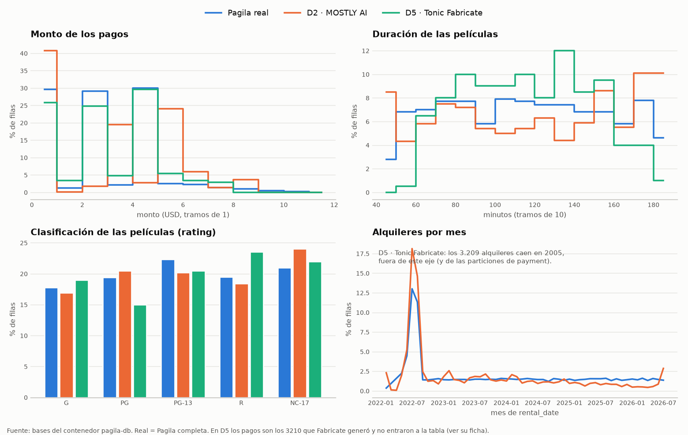

# D5 — Tonic Fabricate — Sintetizar

**Quién / cuándo:** Jero. Archivo generado el 2026-10-10 (fecha del archivo descargado); verificación corrida el 2026-10-10.
**Fuente de cada dato:** D = documentación, P = prueba propia. Salvo donde dice D, todo es P.

[← Puerta de entrada](../../docs/README.md) · [Comparativa de síntesis](../../docs/comparativa.md#d--sintetizar) · [Glosario](../../docs/glosario-y-metodo.md)

## En pocas palabras

- Tonic Fabricate (web, versión de prueba) generó una base desde el esquema de Pagila, sin ver datos reales. Se le pidió el 20 % de las filas y el resultado fue desparejo: entre 0,1 % y 100 % según la tabla.
- Generó el **Sakila clásico** (año 2005, 2 tiendas) en lugar del esquema real. **Todos los pagos quedaron afuera**: sus fechas no caen en ninguna partición de `payment`. No es un problema de formato.
- La estructura relacional está bien: **0 huérfanas y 0 duplicadas**, incluso en los pagos rechazados. Con las fechas corridas a 2022, los pagos cargan sin errores.
- **Calidad 0,601** (penalizada por las fechas y por `payment` vacía). **Riesgo de privacidad bajo** por construcción.

## Entorno

- Equipo de verificación: Mac M5 Pro (arm64), 16 GB de RAM, macOS 26. La generación corre en la nube de Tonic; en el equipo solo se cargan y verifican los datos.
- Herramienta: Tonic Fabricate (web, fabricate.tonic.ai), versión de prueba. No muestra número de versión, así que se registra la fecha de la corrida. Según la página de Tonic, el plan gratuito da USD 5 de crédito por mes (D).
- Proyecto: _(enlace al proyecto de Fabricate)_
- Entrada que se le dio: _(el DDL `data/pagila/01-schema.sql` completo o un recorte; qué tablas)_. **Se pidió el 20 % de la cantidad de filas del original**, para ahorrar créditos de la versión de prueba.
- Prompt usado: _(copiar textual)_
- Salida: `salidas_grandes/fabricate.sql` (no se sube). Se descargó como `pagila_sintetico.sql`. Tamaño: 934 367 bytes, 9424 líneas. sha256: `8961211272f5f4d92721eea312dd59d21e0b6d3c5c2b4c14103229098ab4de43`.
- Contenido del archivo: 22 `INSERT` de varias filas sobre las 15 tablas de Pagila, 15 `TRUNCATE ... CASCADE` al principio, y `SET session_replication_role = 'replica'` al principio y `'origin'` al final. No trae `DROP`, `CREATE` ni transacciones.
- Verificación: PostgreSQL 16.4 del contenedor `pagila-db`; las restricciones se toman de la base común `pagila` (pagila-v4.0.0). Scripts: `d5_fabricate.py` + `scripts/integridad.py` (integridad) y `pruebas/E3-chequeos-propios/evaluar_bd.py` (calidad y privacidad).

## Qué se midió y resultado

Métricas mínimas de «Sintetizar»: tiempo de entrenamiento y de generación, memoria máxima, claves huérfanas o duplicadas, y un reporte de calidad.

- **Tiempo de entrenamiento:** no aplica. Fabricate no entrena con datos propios: genera desde el esquema.
- **Tiempo de generación:** _(lo que muestra Fabricate o cronometrado; captura)_
- **Memoria máxima:** no aplica, corre en la nube de Tonic. La verificación local tardó 1,3 s (D5) y 5 s (E3).

### Cantidad de filas: el 20 % no se respetó de forma pareja

| Tabla | Pagila | Fabricate | Proporción |
|---|---|---|---|
| actor, city, film, film_actor, inventory | 200 / 600 / 1000 / 5462 / 4581 | 40 / 120 / 200 / 1092 / 916 | 20,0 % |
| country | 109 | 22 | 20,2 % |
| category, language | 16 / 6 | 16 / 6 | 100 % |
| address | 1003 | 125 | 12,5 % |
| customer | 999 | 120 | 12,0 % |
| film_category | 2367 | 200 | 8,4 % |
| rental | 51 805 | 3209 | 6,2 % |
| payment | 51 061 | 3210 en el archivo, **0 cargadas** | 6,3 % / 0 % |
| store | 500 | 2 | 0,4 % |
| staff | 1500 | 2 | 0,1 % |

Fabricate reprodujo la forma del **Sakila/Pagila clásico**, no la de Pagila v4: 2 tiendas con 2 empleados, una categoría por película (`film_category` = `film`) y alquileres y pagos entre el **24/05/2005 y el 24/08/2005**. En Pagila v4 hay 500 tiendas y 1500 empleados, y las fechas van de 2022 a 2026.

### ¿Carga tal cual en el esquema de Pagila?

**No del todo.** Se rechazaron 4 de 22 sentencias: los 4 `INSERT` de `payment`, con el error `no partition of relation "payment" found for row`. En Pagila v4, `payment` está particionada por mes de 2022-01 a 2026-07, y los 3210 pagos tienen fechas de 2005. Las mismas 4 sentencias fallan también en la carga sin restricciones, porque la partición es estructural, no una restricción. Resultado: la base queda **sin ningún pago**.

Lo demás carga completo, y las 36 FK de Pagila se pudieron volver a crear después de la carga.

### Claves huérfanas o duplicadas, fila por fila

En las 15 tablas cargadas (`resultados/d5_resumen.md`, sección 2), **0 violaciones** de FK (36), PK (15), UNIQUE (5 índices), NOT NULL (75) y CHECK (1). E3 agrega las dos relaciones que el catálogo no cubre: las FK de `payment` llevadas a la tabla padre y `store.manager_staff_id → staff`. Las dos dan 0 (`pruebas/E3-chequeos-propios/resultados/d5_auditoria/`).

Como `payment` quedó vacía, sus FK se verificaron aparte: se cargaron los 3210 pagos rechazados en una tabla auxiliar (`d5_auditoria.aux.payment_rechazados`) y se cruzaron contra `customer`, `rental` y `staff`. Dieron **0 huérfanas, 0 PK duplicadas, y cada pago corresponde al mismo cliente que su alquiler** (`evidencia/d5_payment_rechazados.txt`).

Conclusión: la estructura relacional que genera Fabricate es coherente. El problema son los **valores de las fechas**, que no respetan las particiones del esquema.

### ¿Qué pasó con las fechas de los pagos?

**No fue un problema de formato, sino de rango.**

- **Formato:** las 3210 fechas de `payment.payment_date` tienen el mismo formato ISO 8601 válido (por ejemplo `'2005-05-24T03:11:13Z'`). PostgreSQL las interpreta sin error: cargaron completas en la tabla auxiliar, que tiene el mismo tipo (`timestamptz`).
- **Rango:** en Pagila v4, `payment` está particionada por mes y solo existen particiones desde `2022-01-01` hasta `2026-08-01` (sin incluir). Fabricate generó pagos entre el 24/05/2005 y el 24/08/2005, como en el Sakila original. Para el año 2005 no existe partición, así que PostgreSQL rechaza la fila (`no partition of relation "payment" found for row`, SQLSTATE 23514). Como cada `INSERT` trae ~1000 filas, se pierde la sentencia entera: 4 sentencias, 3210 pagos.

**Prueba de que la fecha era lo único que fallaba:** se cargaron los mismos 3210 pagos **con la fecha corrida 17 años** (2005 → 2022) en `d5_estricta`, con el esquema completo de Pagila y las FK activas (`session_replication_role = origin`), dentro de una transacción que después se deshizo con `ROLLBACK` (`evidencia/d5_payment_fechas_corridas.txt`):

| Partición | Pagos | Desde | Hasta | ¿Tiene FK declarada? |
|---|---|---|---|---|
| payment_p2022_05 | 284 | 2022-05-24 | 2022-05-31 | sí |
| payment_p2022_06 | 1081 | 2022-06-01 | 2022-06-30 | sí |
| payment_p2022_07 | 1044 | 2022-07-01 | 2022-07-31 | no |
| payment_p2022_08 | 801 | 2022-08-01 | 2022-08-24 | no |

**Entraron los 3210, sin ningún error.**

**Integridad de las claves de los pagos:** **respetada en su totalidad**, verificada de dos formas:

- En los 1365 pagos que caen en particiones con FK (mayo y junio), la validó el propio PostgreSQL al cargarlos.
- En los 3210, incluidos los 1845 de julio y agosto cuyas particiones no tienen FK, la verificó el chequeo de la tabla auxiliar: 0 huérfanas contra `customer`, `rental` y `staff`, 0 `payment_id` duplicados, y cada pago corresponde al mismo cliente que su alquiler (`evidencia/d5_payment_rechazados.txt`).

Corregir la fecha no cambia ninguna clave, así que lo que valida un chequeo vale para el otro.

En resumen: el generador produjo pagos **relacionalmente correctos** pero **temporalmente incompatibles** con el esquema de destino. Un post-proceso que desplazara las fechas al rango de las particiones los haría cargar sin errores, aunque las fechas seguirían sin parecerse a las reales (eso lo mide la sección de calidad).

### Reporte de calidad (SDMetrics, vía E3, contra Pagila completa)

Fabricate no ofrece un reporte de calidad comparado con datos reales, porque no los ve. Se usó el de E3.

| Propiedad | Score |
|---|---|
| **Calidad global** | **0,601** |
| Column Shapes | 0,625 |
| Column Pair Trends | 0,787 |
| Cardinality | 0,427 |
| Intertable Trends | 0,567 |
| **Diagnóstico global** | **0,935** |
| Data Validity / Data Structure / Relationship Validity | 0,893 / 0,970 / 0,943 |

Peores columnas:

- KS = 0 en `rental.rental_date`, `rental.return_date` y `customer.create_date`: fechas de 2005 contra 2022+.
- KS = 0,06 en `film.release_year`.
- TV = 0 en `address.address2`: en Pagila es siempre cadena vacía; Fabricate dejó NULL en 111 filas y texto en 14.
- KS = 0,006 en `store.manager_staff_id`.

Las columnas sin fechas de por medio salen bien, por ejemplo `film.length` 0,89 y `film.replacement_cost` 0,90.

**Cómo leerlo con el 20 %:** la forma de las columnas no depende del tamaño. *Cardinality* sí: penaliza que `payment` haya quedado vacía (`payment → customer` da 0,002) y la reducción despareja (`film_category → category` da 0,000, porque cada película tiene una sola categoría). Las métricas de forma de `payment` salen NaN: no se evaluaron.

Cuatro columnas, Pagila real contra Fabricate (y contra MOSTLY, D2). Los montos son los de los 3210 pagos que no entraron a la tabla:

Fabricate respeta bien los montos terminados en ,99 y reproduce de forma razonable la mezcla de clasificaciones (PG 15 % contra 19 % real; R 23 % contra 19 %). La duración de las películas sigue su propia distribución. Los alquileres caen todos en 2005, fuera del eje.

### Privacidad (Anonymeter y distancia al registro más cercano, vía E3) — sirve para E5

Registro «persona» (customer + address + city + country): 120 filas sintéticas contra 799 reales y 200 de control.

- **Anonymeter:**
  - Singling out: 0,18 univariado y 0,03 multivariado.
  - Linkability: 0,085, con intervalo de confianza 0–0,19.
  - Inference: entre 0 y 0,05 según el secreto; en dos casos el ataque no supera al azar.
- **Distancia al registro más cercano:**
  - 0 % de copias exactas.
  - Distancia mediana a la persona real más cercana: 0,981. Como referencia, el control está a 0,546.
  - Índice de memorización: −1,13, es decir, más lejos de los datos reales que el propio control.
- **Interpretación:** el riesgo es bajo por construcción, porque Fabricate generó desde el esquema y no vio personas reales. El aviso de E3 sobre `--entrenada-con` no aplica en este caso. _(Confirmar que a Fabricate no se le pasó ninguna muestra de datos reales; si se le pasó, hay que volver a interpretar esta sección.)_ Los riesgos que no dan exactamente 0 (singling out univariado, linkability) son compatibles con coincidencias de valores comunes, como nombres frecuentes o países grandes, más que con una filtración.

## Esfuerzo

- Problemas encontrados:
  - El archivo descargado quedó en `~/Downloads`, y macOS no le da a la terminal (iTerm2) permiso para leer esa carpeta (`Operation not permitted`, aun fuera del sandbox de Claude Code). Hubo que copiarlo con el Finder.
  - Docker Desktop estaba en pausa y la primera corrida quedó colgada sin dar error.

## Hallazgos

- Limitaciones vistas en la práctica:
  - **No respeta el esquema real, sino el que «conoce»:** genera el Sakila clásico (2005, 2 tiendas) aunque el DDL de Pagila v4 diga otra cosa. Con particiones por rango de fecha, eso hace que se pierda una tabla entera (`payment`). No es un problema de formato (las fechas son ISO 8601 válidas) sino de rango: con la fecha corrida a 2022, los 3210 pagos cargan sin errores y con todas las claves respetadas.
  - **No respeta una proporción pareja**: se pidió 20 % y salió entre 0,1 % y 100 % según la tabla. Con tablas de referencia chicas (`category`, `language`) quedaron completas, lo cual es razonable, pero `staff` y `store` quedaron casi vacías.
  - **El export desactiva las FK** (`session_replication_role = 'replica'`). Restaurado en una base real con restricciones, cargaría huérfanas sin avisar. En este archivo no había huérfanas, pero la protección queda anulada.
  - El `TRUNCATE ... CASCADE` del principio borra los datos de la base destino: no se puede cargar sobre una base que ya tenga datos.
  - La estructura relacional es coherente: 0 huérfanas y 0 duplicadas, incluso en los pagos rechazados.
- Requisitos que surgen para el sistema:
  - Validar los valores generados contra las restricciones físicas (particiones, rangos, dominios), no solo las FK.
  - Respetar las cardinalidades del original cuando se pide un porcentaje.
  - Generar el export sin desactivar las FK, o avisarlo.

## Evidencia

- [`resultados/d5_resumen.md`](resultados/d5_resumen.md), [`resultados/d5_restricciones.csv`](resultados/d5_restricciones.csv) y [`resultados/d5_conteos.csv`](resultados/d5_conteos.csv) (generados por [`d5_fabricate.py`](d5_fabricate.py)).
- [`evidencia/d5_errores_carga.csv`](evidencia/d5_errores_carga.csv): cada error de psql al cargar (fase, línea del archivo, SQLSTATE, tabla, mensaje).
- [`evidencia/d5_payment_rechazados.txt`](evidencia/d5_payment_rechazados.txt): chequeo de claves de los 3210 pagos que no entraron.
- [`evidencia/d5_payment_fechas_corridas.txt`](evidencia/d5_payment_fechas_corridas.txt): experimento con las fechas corridas 17 años en `d5_estricta` (carga completa, deshecha con `ROLLBACK`).
- [E3 sobre `d5_auditoria`](../E3-chequeos-propios/resultados/d5_auditoria/e3_resumen.md): calidad, privacidad e integridad con la vara común.
- El `.sql` que exportó Fabricate no se sube (está en `salidas_grandes/`). Su sha256 está en «Entorno», para poder verificar que es el mismo archivo.
- Lo esencial va como texto en «Entorno» (prompt, entrada y cantidad de filas pedida). Capturas de la pantalla de Fabricate en `evidencia/`: _(opcionales)_

## Opcional

- ¿Misma semilla, mismo resultado? _(si Fabricate permite fijar semilla o regenerar, comparar el sha256 de dos exportaciones)_
